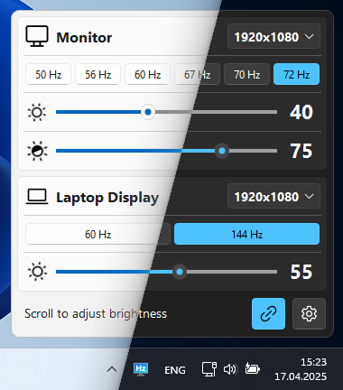

# MoniTune

Easily manage the brightness, resolution, and refresh rate of your monitors in Windows from the system tray.

<div align="center">
  
</div>

## Features
- Adds brightness sliders to the system tray.
- Can automatically change monitor brightness depending on the time of day.
- Control contrast.
- Change monitor resolution and refresh rate from the system tray.
- Eye break reminders.
- Supports dynamic monitor configuration changes.


## Run
```bash
uv run python -m PyInstaller MoniTune.spec
```

## Build
```bash
uv run python generate_qrc.py
uv run pyside6-rcc src/resources.qrc -o src/resources_rc.py
uv run pyinstaller MoniTune.spec
```

## Update dependencies
```bash
uv pip install --upgrade -r requirements.txt
```

## Monitor Settings Migration (After Driver Reinstall)
When reinstalling or updating GPU drivers (e.g. AMD), Windows may assign a new device instance ID to the laptop display or connected monitors. To automatically detect displays, transfer previous configurations (names, order, brightness schedules), and restart MoniTune:

```bash
# Preview proposed changes (Dry Run)
uv run python migrate_monitors.py

# Apply changes and restart MoniTune
uv run python migrate_monitors.py --apply --restart
```